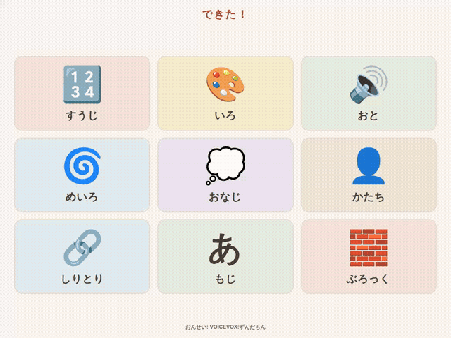
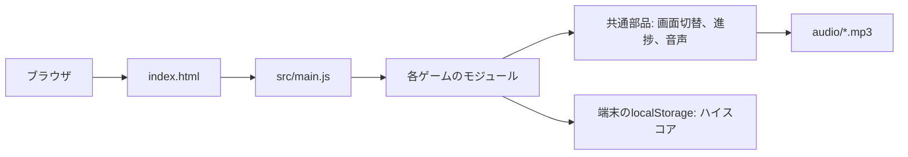

# できた！

幼児が数、色、音、文字、形などで遊びながら学べる、ブラウザ向けのミニゲーム集です。
9種類の遊び(すうじ、いろ、おと、めいろ、おなじ、かたち、しりとり、もじ、ぶろっく)を、文字を読めなくても音声の案内で進められるようにしています。

このリポジトリは、AIを活用したアプリ開発のポートフォリオとして、アプリのソースを独立させた公開版です。
ビルド工程のない静的サイトで、ローカルでもそのまま起動できます。

[公開アプリ](https://dekita.ats030.workers.dev/)はログインなしで遊べます。
音声:VOICEVOX:ずんだもん



**展示は実際の画面を操作したものですが、完了画面はスコアを設定して直接表示しています。**
ぶろっくを最後まで解いた動画ではありません。
タッチ操作の感触、音量、端末ごとの絵文字の字形は、展示では確認できません。

静止画は[タイトル](docs/media/01-home.png)、[すうじ](docs/media/02-count.png)、[いろ](docs/media/03-color.png)、[しりとり](docs/media/04-shiritori.png)、[ぶろっく](docs/media/05-block.png)、[完了画面](docs/media/06-result.png)を参照してください。
[操作動画](docs/media/walkthrough.webm)もあります。

## 解決する課題

幼児向けの学習アプリは、点数や時間制限、失敗の演出で子どもを急かしがちです。
文字を読めない子どもには、ボタンの説明や問題文も伝わりません。
できた！では、問題文と声かけを音声で読み上げ、点数の大小によらず同じ言葉で完了を祝います。
誤答しても盤面を動かさず、「だいじょうぶ！つぎも やってみよう！」と声をかけて続けられるようにしています。

## 実装から読める設計判断

| 課題 | 実装した対応 | 根拠を読める場所 |
| --- | --- | --- |
| 文字を読めない子どもに問題が伝わらない | 問題文と声かけを事前生成した音声で読み上げる | [AudioManager.js](src/modules/core/AudioManager.js)、[SoundData.js](src/modules/data/SoundData.js) |
| 点数や失敗の表示が子どもを急かす | 進捗を丸で示し、正誤で色分けせず、完了は同じ言葉で祝う | [Progress.js](src/modules/core/Progress.js)、[DESIGN.md](DESIGN.md) |
| 小さい指で押しにくい | ボタンと盤面のマスを48px以上に保ち、短い横向き画面も検査する | [style.css](style.css)、[layout.spec.js](tests/e2e/layout.spec.js) |
| 迷路やパズルが解けない配置になる | 正解経路の長さや分岐、完成形を先に作ってから出題する | [PathGenerator.js](src/modules/utils/maze/PathGenerator.js)、[BlockPuzzle.js](src/modules/utils/blocks/BlockPuzzle.js) |
| しりとりの単語と音声がずれる | 単語と音声の定義を1か所にまとめ、音声生成とブラウザ再生で共有する | [ShiritoriWords.js](src/modules/data/ShiritoriWords.js)、[generate-voicevox-audio.cjs](generate-voicevox-audio.cjs) |
| 配信先にリポジトリ全体を上げたくない | 公開する資産だけを `dist/` に複製してから配備する | [build-cloudflare.py](scripts/build-cloudflare.py) |

これらはコードで確認できる実装です。
利用者数や学習効果を、測定なしで実績として記載していません。
画面と遊びの設計方針は[DESIGN.md](DESIGN.md)にまとめています。

## 構成



サーバー側の処理はありません。
公開版は Cloudflare Workers Static Assets で静的ファイルとして配信しています。
[構成と収録範囲](docs/architecture.md)に、配信方法と収録しなかったファイルを記載しています。

| 用途 | 技術 |
| --- | --- |
| 画面とゲーム | HTML、CSS、JavaScript(ES modules、ビルドなし) |
| 音声 | VOICEVOX で事前生成した MP3 |
| 保存 | localStorage(ハイスコアのみ)、移行用の書き出しと読み込み |
| 配信 | Cloudflare Workers Static Assets |
| 検証 | Node.js のテストランナー、Playwright、Python の unittest |

## ローカルで起動する

Node.js 20以上を使います。

```sh
git clone https://github.com/ats030/dekita.git
cd dekita
npm ci
npx http-server -p 8525
```

`http://127.0.0.1:8525/` を開きます。
音声ファイルは収録済みのため、VOICEVOX は不要です。

## 検証と展示の再生成

```sh
npx playwright install chromium
node scripts/run_checks.mjs
node scripts/capture_portfolio.mjs
git add -A
python3 scripts/audit_publication.py
```

`run_checks.mjs` は単体テスト、公開検査の回帰テスト、使い捨てのローカルサーバーに対するブラウザ検査を実行します。
8525番が使用中の場合は `DEKITA_PORT` で別のポートを指定してください。
撮影スクリプトはサーバーを起動せず、ディスク上のファイルを応答して外部リクエストを拒否します。
GIFの生成には ffmpeg が必要です。
撮影結果は全検査の合格後に `docs/media` へ置かれます。
公開検査はステージ済みの内容を読むため、撮り直した画像は `git add` してから検査します。
[検証記録](docs/validation.md)に実行環境、結果、既知の制約を記載しています。

## AIの利用と公開範囲

このアプリの実装と、この公開版の整理、説明文の作成、展示スクリプトの実装には生成AIを利用しています。
個々の設計を誰が発案したかや、人とAIの実装比率はこの公開版では主張していません。
評価の材料として、実装、検証方法、制約を読める形にしています。

運用用のリポジトリ履歴、退役した配備設定、運用ログ、利用者のデータは収録していません。
音声の利用条件と依存パッケージのライセンスは[THIRD_PARTY_NOTICES.md](THIRD_PARTY_NOTICES.md)、収録元の検証用ハッシュは[source-manifest.json](docs/source-manifest.json)を参照してください。
プロジェクト全体へのオープンソース再利用ライセンスは、今回の公開では設定していません。
